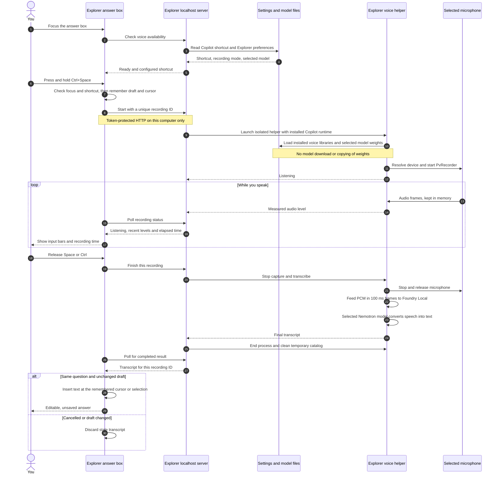

# Explorer for GitHub Copilot

<!-- explorer-current-version:start -->
**Proof of concept, v0.1.19.** Explore an idea through a branching question map inside the GitHub Copilot desktop app. Start with `/explore`, answer the questions that matter, research options when you are unsure, and keep going as deep as you need. Questions expand into workspaces inside the installed map. **History** previews saved revisions and named checkpoints; **Undo** previews the latest committed change before you restore it.
<!-- explorer-current-version:end -->

## Install from GitHub

In the GitHub Copilot desktop app, open **Customize**, use the marketplace settings control, and add:

```text
https://github.com/AndrewGodlewsky/Copilot-Explore
```

Choose the **main** branch if prompted. Find **Explorer** in the `copilot-explorer` marketplace and install it. The exact plugin identifier is **`explorer@copilot-explorer`**.

Or install through Copilot CLI:

```powershell
copilot plugin marketplace add AndrewGodlewsky/Copilot-Explore
copilot plugin install explorer@copilot-explorer
```

Start a **new session** and use `/explore <your idea>`. The repository includes the complete runnable plugin; no build or npm install is needed for the GitHub installation.

If this marketplace is already registered from a local checkout, switch it to GitHub with the following commands, stopping if any command fails:

```powershell
copilot plugin uninstall explorer@copilot-explorer
copilot plugin marketplace remove copilot-explorer
copilot plugin marketplace add AndrewGodlewsky/Copilot-Explore
copilot plugin install explorer@copilot-explorer
```

Exploration files are stored separately and remain intact. For later updates, use **Update** in Copilot's installed plugins or `copilot plugin update explorer@copilot-explorer`, then start a new session.

## Install a development checkout

Requires GitHub Copilot desktop with canvas support and Node.js 22 or later for development commands. The plugin itself uses the SDK/runtime supplied by Copilot; there are no npm runtime dependencies or separate AI keys. The development tests use jsdom.

From this repository:

```powershell
npm run install:copilot
```

The installer checks the package, registers this directory as the `copilot-explorer` marketplace, installs `explorer@copilot-explorer`, and lists plugins. It uses `copilot` from PATH. If that command is unavailable, set `$env:COPILOT_CLI_PATH` to the absolute path of your inspected, installed Copilot executable, then rerun. It does not download a CLI.

Equivalent commands:

```powershell
copilot plugin marketplace add (Get-Location).Path
copilot plugin install explorer@copilot-explorer
copilot plugin list --json
```

Keep the checkout in place: a local marketplace loads it live. Start a **new Copilot desktop session** after installation, then send:

```text
/explore I want to create a neighborhood tool-sharing library
```

`/explore` without a topic opens the entry form. If skill discovery has not refreshed, start another session or ask: **Open the installed Explorer canvas.** Do not use `/create-canvas`, which would create another extension.

Local marketplace installs can show a generic native tab icon due to a host issue observed in Copilot 1.4.2. The canvas is still usable. Prefer the GitHub marketplace installation above for normal use; see [integration notes](docs/copilot-integration.md).

## Use Explorer

While creating a journey, open **Add an objective and success criteria** if you know what you want to understand or decide. Both fields are optional. Use **Objective & criteria** above an existing map to revise them later. They guide future questions and isolated research; they do not answer questions or decide when the journey is complete. Cancel pending Copilot work before editing guidance.

1. Use `/explore` to open your library, or `/explore <idea>` to start a journey. Search saved topics, pin favorites, or show archived journeys. **Open** continues a journey in the current chat; **New exploration** starts another without replacing the saved map. Copilot creates questions in several directions around a new idea.
2. Select a question in the map or searchable **Outline**. The node expands in its branch; its answer, research, and follow-up controls are inside it.
   Use **Collapse branch** to hide a node's descendants while keeping the node and its hidden-question and unresolved counts visible. **Expand branch** restores that branch. **Collapse node** closes the answer editor instead. The Outline keeps every question available; selecting a hidden question reveals its ancestor path. Branch folding changes only this canvas view and keeps saved content, drafts, research and exports intact.
3. Open **Explore options**, then use **Research options** for alternatives, pros/cons, a recommendation, and uncertainty. A separate Copilot researcher works inside this node. Consulted sources are numbered and linked; unsourced reasoning is labeled. **Use recommendation**, **Use this option**, or **Add selected details** appends suggestions to your editable draft. **Undo addition** restores the previous draft until you edit it. Nothing is saved as your answer until you click Save.
4. Write your answer and choose its **Answer state**. New text defaults to Tentative. **Save answer** records text and state together; **Save & explore deeper** also generates follow-up questions on that branch. You can add a question manually.
5. **Finish exploration** saves the record and offers two downloads: Markdown and `.explore.json`. Use **Library** to reopen it from any canvas/session, or **Open file** to import an exported journey.

Answer states distinguish intent from evidence. **Decided**, **Tentative** and **Assumption** require text. **Need evidence**, **Not relevant** and **Revisit later** can have an optional note or no text. Clear the text yourself before saving **Unanswered**. State selection, dictation and research additions remain drafts until Save; changing state alone is recoverable. If another canvas changed the saved journey, use **Refresh saved journey**, then explicitly keep the draft or discard it in favor of the saved answer.

The root is the idea and is excluded from question counts. **Answered** means nonempty saved text; **resolved** means Decided or Not relevant without a needs-review flag; **deferred** means Revisit later; **unresolved** means total questions minus resolved. These counts overlap. Changed ancestor text or state marks descendants for review. Older nonempty answers are Tentative, and empty answers are Unanswered; no old answer is promoted to Decided. See [answer-state semantics](docs/answer-states.md).

The library shows pinned journeys first, then most recently opened journeys. Files saved before the library existed use their last edited date until you open them. Archive hides a journey from the default list; it never deletes the file. Importing an identical saved journey opens the existing one. A changed file with the same identity offers **Open saved** or **Import as new copy**, preserving both versions. Answer drafts save locally after about 500 ms of inactivity and flush before journey switches. Save or clear manual-question drafts and cancel pending Copilot work before switching. **Back to current map** returns to unfinished drafts.

Typed answers, accepted dictation, research additions, and undo are recovered independently for each journey and question. **Saving draft**, **Draft saved locally**, and **Draft could not be saved** describe local draft persistence; **Answer saved** or **State saved** means an explicit save, with the meaning you chose. If the question, committed answer or saved state changed, Explorer keeps the saved answer and offers **Use recovered draft**, **Keep editor draft**, or **Discard draft**. Drafts for removed questions remain available to copy or discard. Another canvas's newer draft is never overwritten silently.

A failed write keeps the editor text and blocks journey switching until retry succeeds or you explicitly **Discard unsaved editor text**; that option leaves any previously stored draft intact. **Save file** exports committed answers and states only; finishing requires resolving local drafts. Manual-question text is still held only in memory. Closing or hiding the page attempts a final flush, but abrupt termination can lose keystrokes within the debounce window or an unfinished write. Wait for **Draft saved locally** before closing. The draft store is limited to 8 MiB and 10,000 journey/question records, including retained clear markers. Malformed files are preserved and need manual restoration; there is no cloud backup. See [draft storage and recovery](docs/drafts.md).

Pan by dragging the background, a compact card, or an expanded question heading. Middle-button dragging also works over the editor. Scroll over the map to zoom around the pointer, or use Ctrl/Command+wheel (including trackpad pinch) anywhere on the map. Normal scrolling inside an expanded node scrolls its contents. The +/? controls zoom up to 300%; click the percentage to return to 100%. **Collapse node** keeps your place and shows a saved-answer preview; **Whole map** collapses the workspace and fits the tree. **Center question** returns to the selected node at reading size. Keyboard users can Tab to nodes (including those off screen), navigate the outline, or press Escape to close the outline or collapse a question. With the map focused, arrow keys pan, +/? zoom, 0 resets zoom, and Home fits the whole map. Window resizing preserves your zoom and position. Ctrl/Command + Enter saves an answer and explores deeper. Revising an answered node preserves its descendants and marks them for review.

Initial questions and **Save & explore deeper** are queued in the attached Copilot chat. Research uses a fresh SDK session with the same verified account and selected enabled Copilot model; normal Copilot usage applies. It receives your saved question path, answers and states with a dedicated [research skill](com.github.copilot/extensions/explorer/research/skills/explorer-research/SKILL.md), and checks web search/fetch availability before inference. The main chat receives no research transcript. Status shows preparation, search, reading and comparison; Cancel stops the research helper. Question cancellation still only discards the result, since Explorer cannot stop the main chat turn.

Research has a three-minute deadline. It reads public web pages, compares practical options and validates its returned data and source URLs. A source must have been successfully fetched to be accepted; this does not guarantee every claim is correct. If pages cannot be consulted, the result is clearly labeled model reasoning. Missing account, model or search access produces an error without falling back to the main chat. Save relevant draft answers and states before research so they are included. Very large maps use a bounded context snapshot and disclose omissions.

## Voice dictation

Focus **Your answer**, hold your Copilot voice shortcut (for example **Ctrl+Space**), wait for **Listening**, then speak. Release to transcribe into the draft; toggle mode uses a second press instead. Review the text before saving. Explorer reads your shortcut and recording mode from Copilot, so you do not need to learn another combination.

The bar beneath the answer distinguishes three stages:

| Stage | What you see | What is happening |
| --- | --- | --- |
| Loading model | Loading indicator and a reminder to wait | The helper loads the selected local model. The microphone has not started yet. |
| Listening | Moving audio bars and elapsed recording time | Your microphone is recording. The bars reflect measured input loudness; silence stays flat. |
| Transcribing | Transcription indicator | The microphone has stopped. The local model is converting the recording into text. |

There is no live partial transcript: the complete text appears after transcription finishes. The indicators respect reduced-motion preferences, and recording states are also provided as text. Each recording loads the model afresh. Escape, leaving the answer, editing the draft, or switching questions cancels dictation. Releasing during loading cancels startup. Recordings are limited to two minutes.

### Microphone and model settings

Open **Voice settings** beneath any expanded answer:

- **Microphone:** choose the system default or a named input device. Explorer checks the name again when recording starts, so changing device order does not select a different microphone. A disconnected or duplicate device name produces an explanation instead of silently switching inputs.
- **Downloaded voice model:** keep **Follow Copilot** or choose a supported downloaded model. The list reads actual local model folders, not the online catalog. Unsupported speech models are visible but disabled. Download additional models through Copilot, then use **Refresh devices and models**.
- **Save voice settings** applies your choices to subsequent recordings and future Explorer sessions. These preferences belong to Explorer; they do not change Copilot's microphone or model selection. Settings cannot change during dictation.

This Windows x64 preview supports the inspected Nemotron English, Nemotron Spanish, and Nemotron 3.5 Multilingual CPU formats with installed Foundry SDK 2.2.1, PvRecorder 1.2.9, and matching desktop libraries. English is the model verified on this machine. Spanish and multilingual compatibility is based on source inspection; their weights were not downloaded or exercised here. Whisper and Parakeet use a different audio path and cannot currently be selected. See the [voice integration findings](docs/voice-integration-research.md).

### From shortcut to answer

Explorer handles recording inside its canvas and reuses Copilot's installed libraries and downloaded model weights. It does not route dictation through the main chat composer. The owner confirmed the v0.1.9 adapter works in the installed app; the earlier v0.1.8 claim of automatic native canvas dictation was incorrect.



PvRecorder captures mono, 16-bit PCM audio at 16 kHz. Foundry Local runs the speech model on your computer after capture ends. Only loudness measurements, status, and the final transcript travel between Explorer's helper, local server, and answer UI; raw audio stays in the helper's memory. The transcript is inserted directly into the draft, without submitting it to chat or saving the answer. Lost connections and timeouts stop capture, and recording IDs prevent late results from entering another question.

## Files and privacy

Committed objective and success criteria are stored on the version-1 journey document and included in JSON and Markdown exports. Older files open with both fields empty. The objective is limited to 2,000 characters and success criteria to 4,000; invalid explicit values are rejected on import. Guidance can influence questions and research, but finishing remains your choice.

Journeys autosave as versioned JSON documents under `~/.copilot/plugin-data/explorer/` (`COPILOT_HOME` is respected). `EXPLORER_DATA_DIR` can override this for testing. New filenames hash the stable journey ID; canvas/session identity is only an attachment. Legacy `.explore.json` files are discovered in place. Opening a journey from another canvas uses the same file and revision protection. Finish also saves a Markdown sibling there. Export names use an exploration identifier; every node's ID and parent relationship are preserved in the resumable file. Pin/archive/recent metadata and canvas bindings live separately in `library.json`; opening or pinning never changes the journey's edited timestamp. See the [library storage contract](docs/library.md).

Question/answer/research data is stored locally as plain text. Generating questions sends only the current map context to the attached chat; the library listing is not added to that context. Research sends a bounded saved-context snapshot to its isolated Copilot session and may include relevant terms in web searches. The plugin reads no repository context and loads no external UI assets. Downloaded files contain the exploration text. Importing a journey keeps the previously open journey in the library. Local answer drafts are stored separately in plain text and never included in exports, question generation, or research input. Only explicitly saved text and states enter the map; only Decided records a user decision.

Research usage receipts are retained under `~/.copilot/plugin-data/explorer/usage/session-state/`, respecting the same directory overrides. They contain model, token/credit metrics and accounting IDs, without prompts, answers, account names or credentials. The temporary research conversation is removed after the helper stops and usage is retained. Cleanup/accounting failures preserve recovery files rather than losing receipts; `usage/recovery-<session>.json` identifies the temporary directory when a pointer can be saved. See [integration notes](docs/copilot-integration.md#background-model-work).

Dictation reads Copilot's voice settings record and local voice assets. Explorer's microphone and model choices are saved in `voice-settings.json` in its data directory, separately from exploration exports and Copilot settings. Audio stays in memory in a separate helper and is processed locally; no recording file is saved. Temporary Explorer catalog metadata is removed when the helper exits. Foundry's native library can emit operational telemetry. Dictated text follows the same save/research behavior as typed answers.

There is no fixed depth limit. This POC supports up to 5,000 nodes, 20,000 characters per answer, 9 MiB of saved map data, and 10 MiB imports. The saved-data limit keeps exports reloadable. Very large maps or prompts can hit host/context limits sooner. A crashed process may leave a `.lock` file; fully exit Copilot before removing only the matching lock, then reopen the map. Corrupt files are preserved and reported, never silently reset.

## Develop and verify

```powershell
npm ci
npm test
npm run check
npm run preview
```

Preview prints a local URL to open in Brave. It uses the real UI and persistence, but has no Copilot connection; AI actions report that limitation. Manual questions, answers, imports and exports work. No browser opens automatically.

The **expanding node is integrated into the installed canvas from v0.1.7**. The [earlier layout studies](docs/prototypes/README.md) remain available with `npm run prototype:layouts` for design reference; those pages use in-memory example data. Use `npm run preview` to inspect the real shipped interface locally.

The [interaction research](docs/explorer-interaction-research.md) examines six product precedents and relevant studies. It records why the owner preferred the expanding node. Its [earlier concept sketches](docs/prototypes/research-directions.html) remain available for reference.

DOM interaction tests run the shipped HTML/JavaScript against the real local server and persistence controller, with geometry stubs because [jsdom does not render a visual browser](https://github.com/jsdom/jsdom#pretending-to-be-a-visual-browser). They cover in-map forms, drafts, saves, research results and follow-up navigation. Layout tests separately check variable-size boxes and branch separation.

For the real SDK/runtime smoke tests, set `COPILOT_SDK_DIR` to the installed SDK directory containing `index.js`, and `COPILOT_CLI_PATH` to its paired runtime executable, then run `npm run e2e` and `npm run e2e:research`. Disposable homes and loopback model/MCP fixtures check plugin discovery, HTTP serving, queued chat delivery, canvas callbacks, isolated research tools/context, cancellation, accounting and export/import without paid inference or browser automation.

`npm run package` creates a clean, dependency-free installable directory under `dist/`. Register that directory as a local marketplace if you prefer a snapshot. There is no build step; the checked JavaScript/HTML/CSS is the shipped code.

For each release, run `npm version <next-version> --no-git-tag-version --ignore-scripts` to update the root package and both lockfile version fields. Update `plugin.json`, `.github/plugin/marketplace.json`, and `com.github.copilot/extensions/explorer/package.json` to the same version. Change only the current-version and installation-check sections marked below and near the top of this README; leave historical version references in place. Prepend a `release-notes.json` entry with the new version and a user-facing summary of at most 400 characters, preserving older entries. Run `npm test`, `npm run check`, and `npm run package` before committing. The check rejects missing or mismatched current release fields, and packaging runs it again.

Manual acceptance in Copilot:

<!-- explorer-install-check:start -->
- Update to v0.1.19, start a new session, invoke `/explore`, and confirm the bottom label reads **Explorer v0.1.19**.
<!-- explorer-install-check:end -->
- Select a question and confirm it expands within the map, with no separate question sidebar. Collapse it and check its saved-answer preview.
- Collapse a branch with an active descendant editor, confirm focus moves to the visible ancestor, then select the hidden question from Outline. Check that its draft text and state return, the other branches stay as they were, and the compact hidden/unresolved counts remain readable in a narrow pane.
- Focus the answer, hold your configured voice shortcut until **Listening**, speak, then release. Confirm the text enters the draft and is not saved automatically. Check Escape cancellation and switching questions.
- Open **Voice settings**, choose a microphone and downloaded model, save, and reopen Explorer to check persistence. Disconnect a selected device and confirm Explorer explains the problem. Check that the recording bars respond to your speech, stay flat in silence, and stop during transcription.
- Answer a question and confirm relevant deeper questions appear.
- Research another question; confirm progress appears in the node and the main chat stays quiet. Inspect relevance, source links and uncertainty. Add a recommendation and selected details to an existing draft, undo an addition, then save explicitly. Cancel another research run and confirm your answer is preserved.
- Export both files, open the JSON in a new canvas, and confirm the full map returns.
- Open Library in a different chat, search/pin/archive/unarchive a journey, then reopen it. Confirm questions arrive in the new attached chat. Try importing a changed export with the same identity and verify both duplicate choices. Type an answer, wait for **Draft saved locally**, reopen the journey and restart Explorer to check recovery. Check changed-answer and cross-canvas recovery choices, explicit discard, and manual-question switch guards.
- Check the narrow layout, keyboard focus, pan/zoom, and light/dark appearance.

Automated runtime fixtures cannot establish desktop rendering, actual model research quality, or successful slash-command discovery in your visible session. Those checks remain manual.

See [AGENTS.md](AGENTS.md) for development rules and [the assessed Copilot practices](docs/copilot-integration.md) imported from Usage Insights and Enhance Prompt.

History retains up to 50 snapshots and 128 MiB per journey, with up to 10 protected named checkpoints. Older unnamed snapshots are pruned first. Restoring preserves local drafts for explicit recovery and creates a new revision when content changes. See [history storage and recovery](docs/history.md) for the commit protocol, limits and recovery instructions.
